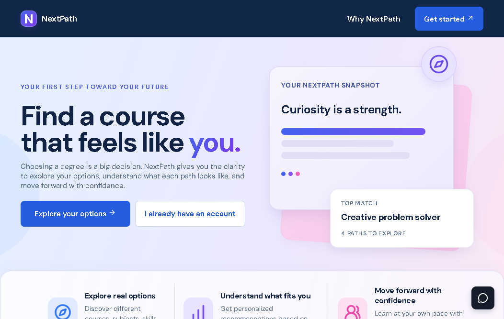
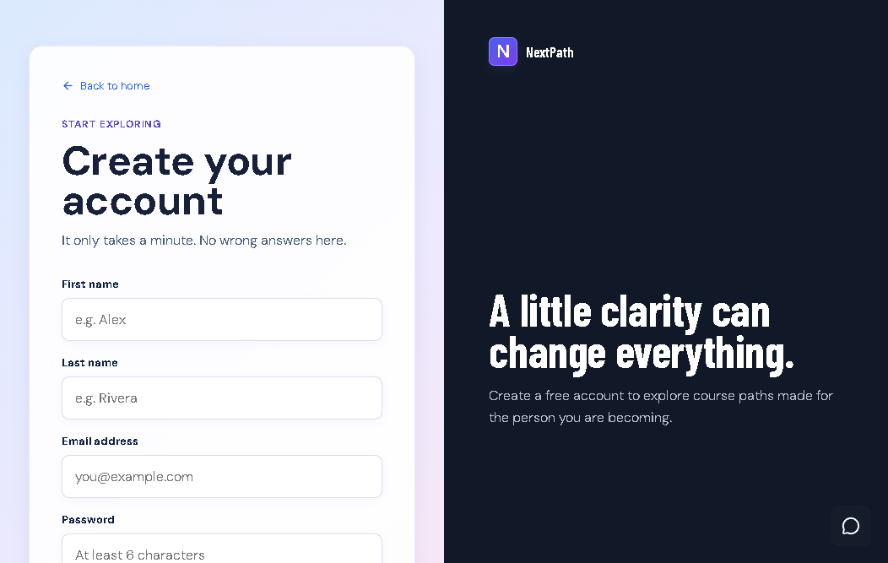

# NextPath

NextPath is a local student course-discovery and guidance platform built for exploring college programs, comparing academic pathways, and helping students choose a program based on their interests, strengths, and goals.

This project combines a MySQL-backed web application, role-based admin controls, deterministic program recommendation logic, and optional AI-powered explanations for course results and system support.

## Preview

<p align="center">
	
	
</p>

## Overview

NextPath helps users:

- browse an active catalog of courses and related information
- search and filter academic programs by category and interest
- complete a personalized Course Match assessment
- receive ranked recommended programs based on their answers
- review their profile activity and personal analytics
- use a support assistant for system guidance

Administrators can manage users, course content, roles, and global app settings. Super admins can manage higher-level access and configuration.

## Key features

- Public course catalog with category browsing and search
- Secure local authentication with password hashing and session cookies
- Email verification and password reset flow using SMTP
- Role-based access for users, admins, and super admins
- Course Match assessment with deterministic scoring and recommendations
- Results-page explanations and AI-assisted follow-up chat
- Analytics tracking for course views, activity, and profile updates
- Local database setup with XAMPP + MySQL/MariaDB

## Tech stack

- Node.js + Express
- MySQL / MariaDB via `mysql2`
- HTML, CSS, and client-side JavaScript
- Node.js `crypto.scrypt` for password and code hashing
- Nodemailer for email delivery
- NVIDIA NIM APIs for AI-assisted chat and explanations
- Built-in Node.js test runner for automated validation

## Architecture

The system is structured as a local web app with a server-side API and a browser UI:

- `server.js` handles the application API, auth flows, database orchestration, and AI integration
- `mysql-database.js` manages database connections, initialization, and schema access
- `app.js` drives the browser experience for browsing, matching, profile management, and admin tools
- `course-match-questions.js` defines the assessment questions and scoring map
- `course-match-scoring.js` calculates deterministic course rankings and percentages
- `database.sql` contains the database schema used by MySQL/MariaDB
- `test/` contains the automated validation suite

## Project status

This repository is currently configured as a local development project for NextPath. It is intended to run on a developer machine using XAMPP and a local MySQL database, with AI features enabled through environment configuration.

## Local setup

Requirements:

- Node.js 20 or newer
- XAMPP with MySQL/MariaDB running
- npm
- a configured local `.env` file

Quick start:

```powershell
npm install
npm start
```

Then open:

- http://localhost:3000
- http://localhost:3000/health

## Environment configuration

Copy `.env.example` to `.env` and configure the required values for:

- database connection (`DB_HOST`, `DB_PORT`, `DB_USER`, `DB_PASSWORD`, `DB_NAME`)
- SMTP credentials for registration and password reset emails
- NVIDIA API key for AI features
- optional super-admin bootstrap variables

Keep `.env` local and do not commit secrets to the repository.

## Security notes

- Passwords are not stored in plain text
- Session tokens are hashed before storage
- Email verification and reset codes are time-limited and rate-limited
- Role-based access is enforced on the server
- Sensitive values remain in environment variables rather than source files

## Repository structure

```text
.
├── app.js
├── server.js
├── mysql-database.js
├── database.sql
├── course-data.js
├── course-match-questions.js
├── course-match-scoring.js
├── index.html
├── styles.css
├── package.json
├── README.md
├── SYSTEM-SPECS.md
├── test/
├── test-support/
├── images/
├── data/
└── .env.example
```

## Notes

NextPath is designed for local use and educational guidance rather than public cloud deployment by default. It emphasizes secure local handling of user accounts, role-based management, course recommendations, and optional AI-based explanation support.

For more detailed implementation and behavior information, see [SYSTEM-SPECS.md](SYSTEM-SPECS.md).
