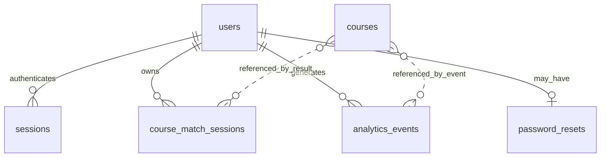

# NextPath System Overview and Specifications

## 1. System overview

NextPath is a locally hosted student course-exploration web application. Visitors can browse an active course catalog and use the public help chat. Registered users complete a ten-question Course Match assessment that deterministically scores active catalog courses, then optionally use NVIDIA-generated explanations and a results-grounded counselor chat; they can also customize their profile and review personal activity. Admins manage ordinary accounts and courses; super admins also manage roles and global settings.

The application is designed for local use by default. Its MySQL/MariaDB database is hosted by XAMPP on the machine running the server; this setup does not provide automatic cloud synchronization or multi-device hosting.

## 2. Technologies and tools

| Area | Technology |
| --- | --- |
| Browser interface | HTML, CSS, and client-side JavaScript |
| Server | Node.js and Express 5 |
| Database | MySQL/MariaDB via `mysql2` (XAMPP-compatible) |
| Password and code hashing | Node.js `crypto.scrypt` |
| Email delivery | Nodemailer with SMTP |
| AI assistant | NVIDIA NIM chat completions API |
| Icons | Lucide |
| Typography | DM Sans and Space Grotesk, loaded from Google Fonts |
| Tests | Node.js built-in test runner |

The npm dependencies are listed in `package.json`. No browser framework or front-end build step is currently required.

## 3. Runtime requirements

- Node.js 20 or newer.
- XAMPP with its MySQL/MariaDB service running.
- npm, for installing dependencies and running project scripts.
- A modern browser with JavaScript enabled.
- A MySQL database and credentials configured in `.env`.
- SMTP configuration for email verification and password setup/reset emails.
- An NVIDIA API key for signed-in AI chat responses. The public chat uses scripted responses and does not require an NVIDIA request.

The app defaults to `http://127.0.0.1:3000`. `PORT` can change the listening port. `DB_HOST`, `DB_PORT`, `DB_USER`, `DB_PASSWORD`, and `DB_NAME` configure the MySQL/MariaDB connection.

## 4. Start, check, and test

```powershell
npm install
npm start
```

Open `http://127.0.0.1:3000`. The health check is available at `/health`.

Available npm scripts:

| Script | Purpose |
| --- | --- |
| `npm start` | Start the local Express server |
| `npm run check` | Run JavaScript syntax checks |
| `npm test` | Run the automated test suite |
| `npm run create-admin` | Create or reset the configured super-admin account |

## 5. Application structure

| File or directory | Purpose |
| --- | --- |
| `server.js` | Express application, authentication, API routes, email, and NVIDIA integration |
| `mysql-database.js` | MySQL/MariaDB connection, schema initialization, and query adapter |
| `database.sql` | MySQL/MariaDB schema export for phpMyAdmin |
| `app.js` | Browser application state, views, course exploration, Course Match, account, and administration UI |
| `course-match-questions.js` | Shared ten-question set and answer-to-course mappings used by the Course Match browser and server |
| `course-match-scoring.js` | Deterministic server-side course ranking and compatibility percentages |
| `styles.css` | Responsive application styling |
| `index.html` | Browser entry point, metadata, stylesheet, favicon, and script references |
| `course-data.js` | Initial course catalog used to seed a new database |
| `admin-bootstrap.js` | Super-admin setup command |
| `test/` | Automated tests for authentication, administration, Course Match, and chat |
| `test-support/` | Test helpers, including captured email messages and an isolated SQLite-only test adapter; the application server uses MySQL/MariaDB |

## 6. Database tables

The server initializes the MySQL/MariaDB schema at startup from `database.sql`. Create the configured database first (default: `nextpath`) or import the schema file through phpMyAdmin.

| Table | Purpose |
| --- | --- |
| `users` | Account names, email, scrypt password hash and salt, profile preferences, role, verification and active status, and creation timestamp |
| `sessions` | Hashed login-session tokens, user association, and expiration |
| `pending_registrations` | Temporary registration data and hashed email-verification codes |
| `password_resets` | Hashed one-time password setup/reset code, expiration, attempt count, and request time |
| `courses` | Course information and JSON-encoded learning topics, subjects, skills, careers, interests, and active status |
| `course_match_sessions` | User-owned conversation, progress, recommendations, and created/updated/completed timestamps |
| `analytics_events` | User-owned page, course, quiz, and profile activity with event timestamps |
| `app_settings` | Site name, public registration flag, and maintenance-mode flag |

Foreign keys associate sessions, Course Match sessions, analytics, and password resets with their users. Account deactivation retains history; permanent deletion cascades associated records. Back up the MySQL/MariaDB database through phpMyAdmin or `mysqldump`.

### 6.1 Data dictionary

| Table | Important columns | Constraints and behavior |
| --- | --- | --- |
| `users` | `id`, `first_name`, `last_name`, `email`, `password_salt`, `password_hash`, `display_name`, `photo_style`, `role`, `email_verified`, `is_active`, `created_at` | Email is case-insensitive and unique. Roles are `user`, `admin`, or `super_admin`. Status values are integer booleans. Password material is a salted scrypt hash, not a plaintext password. |
| `sessions` | `token_hash`, `user_id`, `expires_at` | A hashed random session token is the primary key. A user can have multiple sessions. Expired sessions are rejected and cleaned up opportunistically. |
| `pending_registrations` | `email`, `first_name`, `last_name`, `password_salt`, `password_hash`, `code_salt`, `code_hash`, `expires_at`, `attempts_remaining`, `sent_at`, `resend_count` | Keyed by case-insensitive email. Temporary account data is only promoted into `users` after valid email verification. |
| `password_resets` | `user_id`, `code_salt`, `code_hash`, `expires_at`, `attempts_remaining`, `requested_at`, `reset_token_hash`, `verified_expires_at` | One active reset/setup flow per account. OTP is invalidated after verification; only a hash of the short-lived reset token is persisted. |
| `courses` | `id`, `name`, `category`, `icon`, `description`, `learn_json`, `subjects_json`, `skills_json`, `careers_json`, `interests_json`, `is_active`, `created_at`, `updated_at` | Catalog lists are JSON-encoded arrays. Deactivation is soft; historical results can continue to refer to a course. |
| `course_match_sessions` | `id`, `user_id`, `status`, `answers_json`, `current_step`, `result_json`, `conversation_json`, `created_at`, `updated_at`, `completed_at` | Status is `in_progress` or `completed`. Ten questionnaire choices, progress, scored recommendation snapshots, explanations, and chatbot conversation are persisted as JSON/step data. Completion requires all ten answers; completed scores are read-only. |
| `analytics_events` | `id`, `user_id`, `event_type`, `page`, `course_id`, `occurred_at` | Event type is constrained to supported app events. Events belong to a user and are retained on account deactivation. |
| `app_settings` | `setting_key`, `setting_value` | Key/value settings include `site_name`, `registration_enabled`, and `maintenance_mode`; boolean values are stored as the strings `true` and `false`. |

Course Match result snapshots store the displayed course details with the result. This allows a user to review a completed recommendation after that course has been changed or deactivated.

### 6.2 Relationships



The course references in JSON results and analytics are application-level identifiers, not foreign-key constraints. Course IDs are not reused when an administrator creates a new course.

## 7. Main features and permissions

### Public visitors

- Browse active courses and their subjects, skills, careers, and interests.
- Use the scripted public assistant for common NextPath questions.
- Register if public registration is enabled.

### Registered users

- Verify their email during registration.
- Log in and update their display name and placeholder avatar style.
- Complete ten questions about interests, skills, strengths, hobbies, personality, learning preferences, and career goals. The server scores active catalog courses, while NVIDIA may explain results and answer follow-up questions using the saved answers and recommendations. Sessions can be resumed and completed recommendations reviewed.
- View personal analytics and recent activity.
- Use the system-focused NVIDIA assistant.
- Set or reset a password with an emailed one-time code.

### Admins

- View administration statistics and user lists.
- Create accounts with email-based password setup, edit user names, send reset codes, and deactivate/reactivate ordinary users.
- Add, edit, and deactivate courses.
- Cannot assign administrator roles or change global settings.

### Super admins

- Perform admin functions.
- Assign or change account roles, subject to protections against self-lockout and removing the last active super admin.
- Change the site name, public-registration setting, and maintenance mode.

## 8. API surface

The browser communicates with the local server using JSON endpoints. Protected routes use the HTTP-only `nextpath_session` cookie.

| Route group | Examples | Purpose |
| --- | --- | --- |
| Health and public data | `GET /health`, `GET /api/courses`, `GET /api/settings/public` | Health, active course catalog, and non-sensitive public settings |
| Authentication | `/api/auth/*` | Registration, email verification, login, session restoration/logout, and password reset |
| User profile and activity | `/api/profile`, `/api/analytics` | Update the signed-in profile and access personal analytics |
| Course Match | `/api/course-match/sessions`, `/api/course-match/sessions/:id/complete`, `/api/course-match/chat` | Create, list, save, complete, and resume scored recommendations and related conversations for the signed-in user |
| Assistant | `POST /api/chat` | Send a system-scoped chat request; signed-in AI calls go to NVIDIA |
| Administration | `/api/admin/*` | Role-protected user, course, settings, and overview operations |

### 8.1 Route reference

| Method | Path | Access | Purpose |
| --- | --- | --- | --- |
| `GET` | `/health` | Public | Check server and MySQL availability |
| `GET` | `/api/courses` | Public | List active courses |
| `GET` | `/api/settings/public` | Public | Read site name and public availability flags |
| `POST` | `/api/auth/register` | Public | Request a registration email code |
| `POST` | `/api/auth/verify-registration` | Public | Verify a code and create the account/session |
| `POST` | `/api/auth/resend-registration-code` | Public | Resend an eligible registration code |
| `POST` | `/api/auth/login` | Public | Authenticate and create a session |
| `GET` | `/api/auth/session` | Cookie if signed in | Restore the current user |
| `DELETE` | `/api/auth/session` | Cookie if signed in | Log out and expire the session cookie |
| `POST` | `/api/auth/request-password-reset` | Public, email | Request a code; response does not reveal whether the account exists |
| `POST` | `/api/auth/verify-password-reset` | Public, email + OTP | Verify OTP and receive a short-lived, single-use reset token |
| `POST` | `/api/auth/reset-password` | Public, email + verified reset token | Set/reset the password after OTP verification |
| `PATCH` | `/api/profile` | Signed-in user | Update display name and avatar style |
| `GET`, `POST` | `/api/analytics` | Signed-in user | Read personal analytics or record an event |
| `GET`, `POST` | `/api/course-match/sessions` | Signed-in user | List saved sessions or create one |
| `PUT` | `/api/course-match/sessions/:id` | Owning signed-in user | Save ten-question assessment progress |
| `POST` | `/api/course-match/sessions/:id/complete` | Owning signed-in user | Score saved answers and generate grounded explanations |
| `POST` | `/api/course-match/chat` | Owning signed-in user | Ask questions about completed results using the saved answers and active catalog |
| `POST` | `/api/chat` | Signed-in user | Ask the NVIDIA-backed assistant |
| `GET` | `/api/admin/overview` | Admin or super admin | Read scoped system usage statistics |
| `GET`, `POST` | `/api/admin/users` | Admin or super admin | List accounts or create an account |
| `PATCH`, `DELETE` | `/api/admin/users/:id` | Admin or super admin | Update account details/role or deactivate |
| `POST` | `/api/admin/users/:id/password-reset` | Admin or super admin | Email a setup/reset code |
| `GET`, `POST` | `/api/admin/courses` | Admin or super admin | List courses or add a course |
| `PUT`, `DELETE` | `/api/admin/courses/:id` | Admin or super admin | Edit or deactivate a course |
| `GET`, `PUT` | `/api/admin/settings` | Super admin | Read or update global settings |

## 9. Security and privacy notes

- Passwords, email codes, and login tokens are not stored as plaintext: passwords and one-time codes use salted scrypt hashes, and login tokens use hashes.
- Authentication cookies are HTTP-only and use `SameSite=Lax`; production cookies are marked `Secure`.
- Admin APIs enforce roles on the server, not only in the browser interface.
- User-list API responses do not include password hashes or session tokens.
- Email codes expire and have attempt limits; registration and code requests are rate-limited.
- Chat requests are length-limited and rate-limited. The assistant is instructed to answer only verified NextPath questions, but model guardrails are not a guarantee; do not send secrets or rely on its answers for consequential decisions.
- Signed-in system-help chat messages are sent to NVIDIA and are not persisted by NextPath. Course Match messages are sent to NVIDIA with the active catalog and are saved in the user's `course_match_sessions` record. Public chat replies are scripted.
- Keep `.env` private and ignored by version control. Use `.env.example` only as a template; never put actual API keys, SMTP passwords, or admin passwords in source files.

### 9.1 Request limits and code expiry

| Control | Current behavior |
| --- | --- |
| Registration and verification requests | Up to 10 requests per IP per minute |
| Registration email code | Expires after 10 minutes; five attempts; up to three resends; 60-second resend cooldown |
| Password setup/reset code | Expires after 10 minutes; five attempts; 60-second resend cooldown; 20 reset-related requests per IP per minute |
| Verified password-reset token | Expires 5 minutes after OTP verification; single-use |
| AI chat message | 1,200 characters maximum |
| AI chat history | Up to four previous user messages; 2,400 characters combined |
| AI chat requests | Up to eight requests per account and per IP per minute |
| NVIDIA request timeouts | 10 seconds per model request, 40 seconds total for fallback attempts |

These are application-level controls. If the server is exposed to a network, also use network-level protection, secure SMTP credentials, a strong super-admin password, and regular backups.

## 10. Environment configuration

Copy `.env.example` to `.env` and set values locally as needed:

| Variable | Purpose |
| --- | --- |
| `PORT` | Optional HTTP listening port |
| `DB_HOST` | MySQL/MariaDB host (default `127.0.0.1`) |
| `DB_PORT` | MySQL/MariaDB port (default `3306`) |
| `DB_USER` | Database account (default `root`) |
| `DB_PASSWORD` | Database password (default empty for standard local XAMPP) |
| `DB_NAME` | Database name (default `nextpath`) |
| `NVIDIA_API_KEY` | NVIDIA NIM authentication key |
| `NVIDIA_MODEL` | Preferred NVIDIA chat model |
| `SMTP_HOST`, `SMTP_PORT` | SMTP server and port |
| `SMTP_USER`, `SMTP_PASS` | SMTP authentication credentials |
| `SMTP_FROM` | Optional permitted sender identity |
| `SUPER_ADMIN_EMAIL`, `SUPER_ADMIN_PASSWORD` | One-time/bootstrap super-admin configuration |

Restart the server after changing environment settings. Remove the bootstrap password from `.env` after creating the super-admin account.

## 11. Current limitations

- The default database is local to the server machine; Firebase data is not automatically imported.
- Profile images are placeholder styles; photo uploads are not implemented.
- Public assistant replies are scripted, while the NVIDIA assistant requires server-side configuration.
- Course Match scores active courses deterministically from the ten questionnaire answers. NVIDIA explains the fixed results and powers an optional results-grounded chatbot; signed-in conversations and recommendation snapshots are persisted in MySQL/MariaDB.
- There is no general in-app database table browser. Inspect the configured database in phpMyAdmin.

## 12. Core data flows

### Registration and login

1. A visitor submits their name, email, and password over the local application API.
2. The server validates public-registration settings and input, hashes the password and a generated code, and sends the code through configured SMTP.
3. A valid code creates the user record and an HTTP-only session cookie. The browser never receives password hashes or session-token hashes.
4. Login verifies the submitted password using scrypt, then stores only a hash of a newly generated session token.

### Password setup and reset

1. The user submits their email address to request a one-time code. The response is intentionally generic so it does not reveal whether an account is registered.
2. If an eligible active account exists, the server emails a six-digit code. Existing cooldowns are respected.
3. The user submits the email and code for verification. Failed attempts are counted; a correct code is invalidated and exchanged for a random reset token that expires after five minutes.
4. The user can then submit a new password with that token. The server validates and consumes the token, hashes the new password, marks the email verified, and invalidates existing sessions.
5. An OTP alone can never change the password; a valid, verified reset token is required.

### Course Match

1. A signed-in user starts or resumes a saved session and answers ten multiple-choice questions about interests, strengths, hobbies, learning preferences, personality, and career goals. Each answer and the current question are persisted in `course_match_sessions`; previous/next navigation preserves answers.
2. The completion endpoint requires ten valid answers, scores each active course by the proportion of selected answers whose mapping includes it, sorts ties deterministically, and stores up to three results with fixed compatibility percentages.
3. NVIDIA may explain the server-ranked results using the answer evidence and catalog facts. Model output cannot change rankings or scores; if unavailable, the server creates evidence-based fallback explanations.
4. The results page displays course details and provides a chatbot grounded in the saved answers, recommendations, and active catalog. Conversation and course snapshots are persisted. Completed recommendation scores are read-only and can be reviewed later.

### Admin and course maintenance

1. The server identifies the account from the session cookie and enforces its role on every protected endpoint.
2. Admins can manage ordinary accounts and courses. Super admins may also change roles and site-wide flags.
3. Deactivation disables login and invalidates sessions without deleting the user's historical activity or Course Match data.
4. Inactive courses no longer appear in the public catalog. Previously saved Course Match results retain their snapshot.

## 13. Operational notes

- The default database name is `nextpath`; configure it using `DB_NAME`.
- Use phpMyAdmin or `mysqldump` to back up the database.
- Schema creation and compatibility migrations run when `server.js` opens the database. Keep a backup before deploying code that changes schema behavior.
- `npm test` uses temporary test databases and captured email transports; it does not need to send real SMTP messages.
- Check `GET /health` after startup. A successful response reports MySQL availability; it does not test SMTP or NVIDIA credentials.
- The current default binding is loopback (`127.0.0.1`). Changing network exposure requires deliberate deployment, firewall, TLS, and credential decisions not covered by this local setup.
